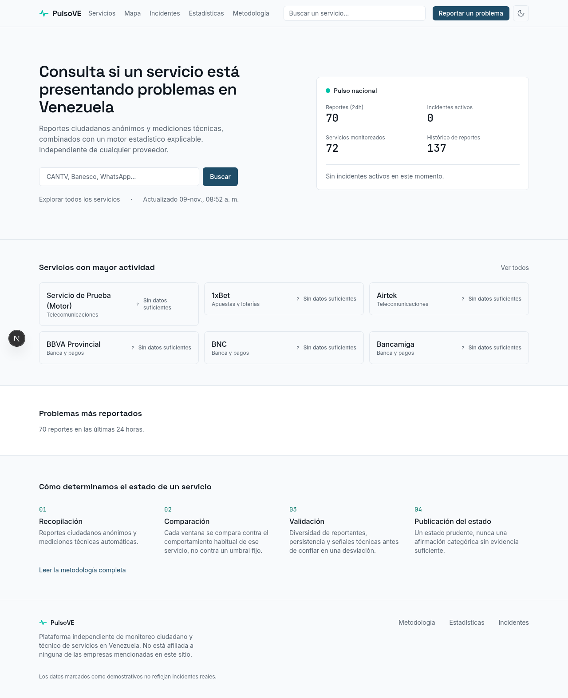

# Demo local de PulsoVE para Windows

[**Descargar la demo completa (ZIP, 2 MB)**](https://github.com/medinacaj/web-downdetector-ve/raw/refs/heads/demo/windows-evaluation/demo-windows/PulsoVE-demo-Windows.zip)

Si el enlace directo no inicia la descarga, abre [el archivo en GitHub](https://github.com/medinacaj/web-downdetector-ve/blob/demo/windows-evaluation/demo-windows/PulsoVE-demo-Windows.zip) y pulsa **Download raw file**. Si el repositorio es privado, inicia sesión con una cuenta que tenga acceso.

1. Instala y abre [Docker Desktop para Windows](https://docs.docker.com/desktop/setup/install/windows-install/) con contenedores Linux.
2. Extrae **PulsoVE-demo-Windows.zip** completo a una carpeta local.
3. Ejecuta **INICIAR-DEMO.cmd**. La primera preparación necesita Internet y puede tardar varios minutos.
4. La web abrirá **http://localhost:3080** cuando esté lista. Ese enlace funciona en tu propio equipo después de iniciar la demo.

Ejecuta **DETENER-DEMO.cmd** para detenerla conservando sus datos. Usa datos ficticios. No necesitas hosting ni dominio.

## Ver el progreso sin instalar la demo

- [Video real del sitio funcionando, 25 segundos](https://github.com/medinacaj/web-downdetector-ve/raw/refs/heads/demo/windows-evaluation/demo-windows/PulsoVE-recorrido.mp4).
- Dentro del ZIP, abre **LEEME.html** para ver el video, las capturas y las instrucciones.

## Alcance de la entrega y pruebas

Esta rama entrega un paquete autocontenido. **Usa el ZIP de esta carpeta** para evaluar las mejoras; el código fuera del paquete corresponde a la rama base del repositorio. El código de la aplicación dentro del ZIP parte del commit `6946e5c138ab5333d51f60499b8e4305230a3ebd` e incorpora únicamente la configuración de la demo local.

La aplicación y PostgreSQL se probaron en contenedores Linux: inicio, recuperación de una preparación interrumpida, conservación de reportes al reiniciar y envío real desde Chromium con respuesta HTTP 201 y persistencia en la base de datos. Los lanzadores CMD se revisaron estáticamente; no se ejecutaron en Windows en este entorno. Véase [VALIDACION.json](VALIDACION.json).

Las claves se generan al iniciar en tu equipo. El paquete no incluye las credenciales ni las bases del entorno de desarrollo. Solo publica la web en el puerto local 3080; PostgreSQL no publica un puerto al host. Es una demo para evaluación, con señales ficticias, sin Redis, Turnstile ni sondeos externos. No es un despliegue de producción.

Los hashes de los archivos están en [SHA256SUMS.txt](SHA256SUMS.txt).
