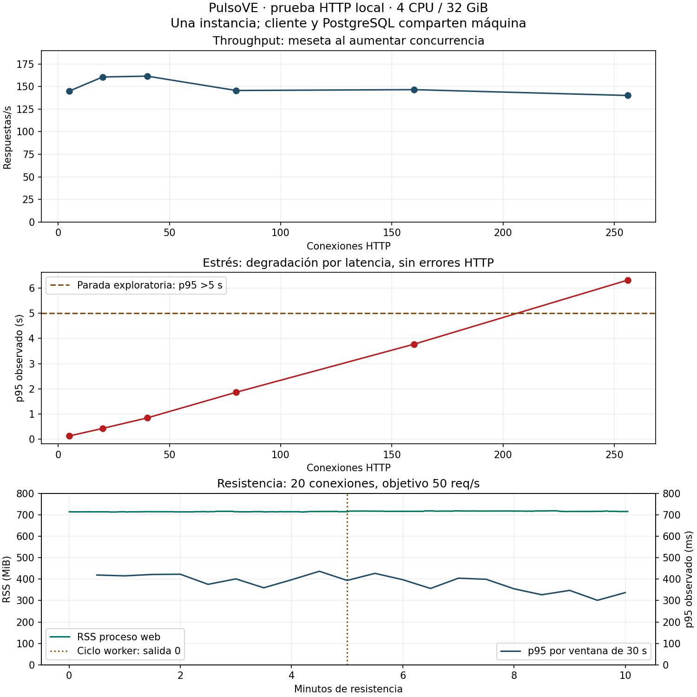

# Resultado de pruebas de carga — 04-11-2026

**La instancia local respondió sin errores observados, pero se saturó por latencia al aumentar concurrencia.** La prueba de resistencia inicial completó diez minutos a unas 50 solicitudes/s. Esto no representa una capacidad garantizada para producción ni una prueba de resistencia de horas.

## Alcance y evidencia

- Código de la aplicación: `306b65007b50c28e7f0710ed49f46969db37d2ec`. Run ID: `f45a0a2d1ecd6876`.
- Inicio: 04-11-2026 01:09:17; fin: 04-11-2026 01:24:59, hora de Santiago.
- Máquina: cuota de 4 CPU, 32 GiB; Node v24.19.0; autocannon 8.0.0; una instancia Next.js en modo producción y PostgreSQL local. Generador, web y DB comparten recursos.
- Base nueva: 71 servicios, 24 estados y 20.000 reportes ficticios iniciales. Tráfico previsto: 10% HTML estático, 30% HTML dinámico, 50% lectura API y 10% POST, sin think time humano. La mezcla real queda en el JSON por ruta.
- Protocolo y límites: [PRUEBAS-CARGA.md](PRUEBAS-CARGA.md). No se modificó el código funcional del sitio durante la medición.

## Mediciones

RPS informado por autocannon; percentiles calculados de la duración HTTP de las **respuestas recibidas**. No incluyen tiempos de peticiones sin respuesta. `HTTP error` significa respuesta no 2xx; errores de transporte y timeouts se contaron aparte.

| Fase | Conexiones | Duración s | Respuestas/s | p95 ms | p99 ms | HTTP error | Transporte |
| --- | ---: | ---: | ---: | ---: | ---: | ---: | ---: |
| Calentamiento | 2 | 15,03 | 77,74 | 97,90 | 125,44 | 0 | 0 |
| Referencia | 5 | 30,03 | 145,04 | 120,91 | 151,63 | 0 | 0 |
| Carga | 20 | 60,08 | 160,64 | 421,01 | 499,88 | 0 | 0 |
| Estrés 40 | 40 | 30,14 | 161,57 | 838,91 | 974,89 | 0 | 0 |
| Estrés 80 | 80 | 30,03 | 145,67 | 1.859,66 | 2.184,17 | 0 | 0 |
| Estrés 160 | 160 | 30,04 | 146,60 | 3.775,06 | 4.205,66 | 0 | 0 |
| Estrés 256 | 256 | 30,07 | 140,14 | 6.325,15 | 7.021,02 | 0 | 0 |
| Recuperación tras estrés | 5 | 20,01 | 150,65 | 115,30 | 139,72 | 0 | 0 |
| Pico | 128 | 20,04 | 136,31 | 3.275,93 | 4.047,67 | 0 | 0 |
| Recuperación tras pico | 5 | 30,02 | 146,74 | 122,35 | 148,73 | 0 | 0 |
| Resistencia inicial | 20 | 600,59 | 50,03 | 372,95 | 520,01 | 0 | 0 |
| Recuperación final | 5 | 20,01 | 122,90 | 128,27 | 167,00 | 0 | 0 |

Total: **75.587 respuestas recibidas**; 76.343 solicitudes contabilizadas como enviadas por la herramienta. Se completaron cero respuestas no 2xx, cero errores de transporte, cero timeouts y cero cuerpos inválidos en los contratos comprobados. Al terminar cada fase, la herramienta cierra conexiones con solicitudes pendientes: la diferencia enviado/recibido no debe ocultarse ni calificarse automáticamente como éxito o pérdida de datos.

### Carga, estrés y pico

El throughput subió de 145 a 161–162 req/s entre 5 y 20–40 conexiones, pero después quedó en una meseta y cayó a 140–147 req/s. El p95 pasó de 121 ms a 421, 839, 1.860, 3.775 y 6.325 ms. El escalón de 256 detuvo los aumentos por el límite preventivo de p95 >5 s, **no por un colapso ni por errores HTTP**. No se buscó romper el sistema indefinidamente.

El pico de 128 conexiones tuvo p95 de 3.276 ms. Al volver a cinco conexiones, las recuperaciones tras estrés/pico alcanzaron p95 de 115/122 ms, próximos a la referencia de 121 ms. La recuperación final fue de 128 ms y 123 req/s, frente a 145 req/s al principio. El dataset creció durante el ensayo; no se atribuye toda diferencia a concurrencia o degradación temporal.

### Resistencia inicial

- Duración real: **600,59 s**; objetivo 50 req/s; resultado 50,03 req/s y 30.014 respuestas. P95 observado 372,95 ms; p99 observado 520,01 ms.
- RSS del proceso web en resistencia: 713,22–719,24 MiB. Mediana de primer/último minuto: 714,12 → 715,87 MiB. No se concluye ausencia de fugas a partir de diez minutos.
- Pico de RSS de toda la corrida: 721,28 MiB. Memoria máxima observada del cgroup completo: 2,93 GiB de 32 GiB. Se observaron hasta 22 conexiones en la base de fixtures.
- El worker se ejecutó a mitad de la resistencia y terminó con código 0 en aproximadamente 2,8 s. No demuestra que el scheduler o alertas del hosting estén configurados.
- El JSON original conserva el histograma de autocannon para la prueba de tasa limitada, con su corrección de omisión coordinada. No mezclar esos percentiles con los observados de la tabla como si fueran el mismo método.

## Diagnóstico y siguiente acción

El directorio sin filtro fue la ruta más lenta durante la resistencia: p95 desde construcción del request de unos 558 ms; el filtrado tuvo unos 270 ms. Son tiempos del cliente y pueden incluir preparación/conexión; no son un perfil interno del servidor. En `getDirectoryServices` y `getHomeData` se consulta el estado por cada servicio: es un candidato concreto para reducir viajes a DB mediante consultas por lote, **no una causa raíz demostrada por este ensayo**. Priorizar perfilado y conteo de consultas sobre datos ficticios, optimizar y repetir con el mismo dataset/protocolo antes de decidir capacidad de hosting.

## Integridad y limpieza

Se observaron 7.244 respuestas 201. La base terminó con 27.258 filas: 20.000 iniciales más 7.258 escrituras. Algunas solicitudes en vuelo pueden completar su escritura aunque su respuesta no se contabilice al cortar una fase. La comprobación es agregada; **no verifica la persistencia individual de cada ID**.

El artefacto original marcó `completed`: significa secuencia finalizada, no aprobación universal ni cumplimiento de un SLO. La sesión original ya no permitió recuperar su código de salida; se verificaron por separado todos los resultados, duración de resistencia, contratos, salida del worker, ausencia de la base temporal y cierre del puerto del servidor. Esa comprobación está en `verification.json` dentro del directorio del run.

Se preservaron los resultados originales y el script efectivamente ejecutado con SHA-256 `9532adc33159396aeeb93ec2a91d894696d24d98b5c1e7a39a828f3e7c319821` en `.runtime/load-tests/f45a0a2d1ecd6876/`. El script del repositorio recibió después mejoras de metadatos: distinguir observaciones de ejecución, registrar salida y limpieza e identificar el conteo como agregado. No se cambiaron las mediciones originales para hacerlas pasar.

## Límites

No se probaron hosting, red WAN, TLS, CDN/WAF, carga de assets/JavaScript, usuarios reales, autenticación, Redis ni Turnstile real. No es una medición de Core Web Vitals. El generador usa conexiones HTTP, no usuarios humanos; las visitas reales suelen tener pausas y mezclas distintas. Tampoco se evaluó una avalancha sostenida por encima de 256 conexiones ni horas de resistencia. El resultado sirve para comparar mejoras en este entorno, no para prometer una cifra de usuarios soportados en producción.

Datos para revisión: [JSON de resumen](evidencias/carga-2026-11-04.json), [CSV de fases](evidencias/carga-2026-11-04.csv). Los JSON nativos por fase, series completas, log limitado y harness ejecutado permanecen en el directorio local del run, ignorado por Git.
