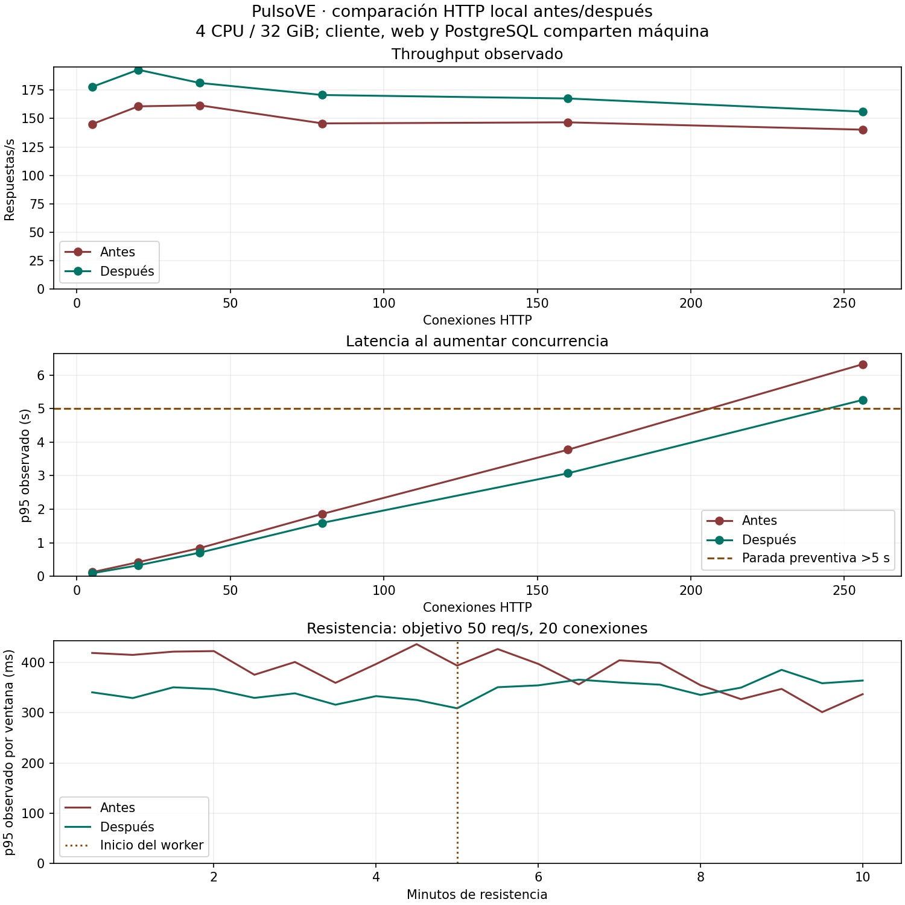

# Optimización de listados y repetición de carga — 04-11-2026

Se eliminó la consulta por servicio al obtener estados del directorio y del inicio. Con 71 servicios, PostgreSQL real registró **72 → 2 consultas en el directorio y 77 → 7 en el inicio**. La repetición HTTP mostró la comparación que figura abajo; persiste la saturación por latencia con concurrencia alta.

## Cambio y pruebas funcionales

Se lee en un único lote el incidente abierto más reciente de cada servicio; los servicios sin incidente abierto conservan `insufficient_data`. Con varios abiertos, antes se tomaba uno sin orden; ahora se aplica `startedAt DESC, id DESC`, consistente con el detalle, que también incorpora el desempate. No se añadió caché, dependencia, migración ni modificación de cuotas. Las agregaciones, filtros y ordenamientos se conservaron.

La regresión utiliza una base nueva con 71 servicios activos y otro inactivo, categorías, reportes e incidentes ficticios. Sustituye únicamente la conexión por Drizzle/PostgreSQL real con contador SQL. Antes fallaron los dos presupuestos y la selección de incidente; después pasaron los cinco casos. Cubren conteos sin multiplicación por incidentes, reportes antiguos, búsqueda, categorías, actividad/estabilidad, estado/total, entradas vacías, resueltos y empates. Este fixture funcional es distinto del dataset de 20.000 reportes del ensayo HTTP.

Validación del cambio: suite completa **161 tests / 22 archivos**; unitarias 134 e integración 27; `check:standards`, `typecheck` y build de producción correctos. Revisión independiente estática del diff `6171cc5..e36d165`: sin hallazgos P0–P3. Los logs RED/GREEN/build permanecen en `/workspace/.cloud-setup/listing-*.log`.

Cierre del 09-11-2026: al retomar el entorno, PostgreSQL local estaba detenido. La primera comprobación falló en las tres suites que requieren DB (`api-reports`, `db-integrity`, `listing-queries`); se conservó en `listing-resume-db-off.log`. Tras iniciar el PostgreSQL existente, la suite completa volvió a aprobar 161/161; estándares y tipos también correctos. No se modificó código ni se repitió la carga. La revisión independiente del informe y sus datos no encontró discrepancias ni conclusiones injustificadas.

## Protocolo y procedencia

- Antes: código `306b65007b50c28e7f0710ed49f46969db37d2ec`, run `f45a0a2d1ecd6876`; [informe original](RESULTADOS-CARGA-2026-11-04.md), sin reescribir sus resultados.
- Después: código `e36d165c8fad97ff7b63931de826e1b0066338b8`, run `c4d1af1aff68a6d9`. Inicio 04-11-2026 18:10:28; fin 04-11-2026 18:26:10, hora de Santiago. Las evidencias JSON conservan UTC.
- Mismo entorno con cuota 4 CPU / 32 GiB, Node v24.19.0, autocannon 8.0.0, servidor Next.js de producción, PostgreSQL local, pipelining 1 y timeout 10 s. Generador, web y DB comparten recursos.
- Mismo [protocolo](PRUEBAS-CARGA.md): 71 servicios, 24 estados y 20.000 reportes ficticios iniciales distribuidos en seis horas, diez rutas con mezcla prevista 10% estático / 30% HTML dinámico / 50% API lectura / 10% POST. Mismas fases, recuperación, pico y resistencia de 600 s a objetivo 50 req/s.
- Son corridas independientes, realizadas en momentos distintos, con IDs y tiempos regenerados según la misma distribución, no una copia idéntica de filas. El dataset crece según las escrituras de cada corrida. No hubo builds, tests ni tráfico adicional durante la medición; se hicieron lecturas estáticas y preparación de documentación. No se modificó código del sitio durante el ensayo.

## Comparación de mediciones

Percentiles observados de respuestas recibidas; no incluyen solicitudes sin respuesta. RPS de autocannon. Se compara el mismo método: el histograma corregido de la herramienta para tasa limitada se conserva por separado en el JSON.

| Fase | Conexiones | RPS antes | RPS después | p95 antes ms | p95 después ms | p99 después ms |
| --- | ---: | ---: | ---: | ---: | ---: | ---: |
| Calentamiento | 2 | 77,74 | 104,94 | 97,90 | 63,48 | 81,18 |
| Referencia | 5 | 145,04 | 177,74 | 120,91 | 90,28 | 109,87 |
| Carga | 20 | 160,64 | 192,77 | 421,01 | 326,05 | 383,77 |
| Estrés 40 | 40 | 161,57 | 181,20 | 838,91 | 703,71 | 813,01 |
| Estrés 80 | 80 | 145,67 | 170,60 | 1.859,66 | 1.593,27 | 1.790,89 |
| Estrés 160 | 160 | 146,60 | 167,54 | 3.775,06 | 3.072,27 | 3.431,67 |
| Estrés 256 | 256 | 140,14 | 156,00 | 6.325,15 | 5.259,98 | 5.989,41 |
| Recuperación tras estrés | 5 | 150,65 | 163,31 | 115,30 | 103,93 | 122,16 |
| Pico | 128 | 136,31 | 145,60 | 3.275,93 | 2.566,79 | 3.463,58 |
| Recuperación tras pico | 5 | 146,74 | 145,20 | 122,35 | 116,10 | 140,32 |
| Resistencia 10 min | 20 | 50,03 | 50,00 | 372,95 | 347,24 | 463,41 |
| Recuperación final | 5 | 122,90 | 140,35 | 128,27 | 105,89 | 128,52 |

En carga (20 conexiones), RPS cambió 160,64 → 192,77 (**+20,0%**) y p95 421,01 → 326,05 ms (**−22,6%**). Son diferencias observadas en una corrida por versión; no estiman significación estadística ni atribuyen todo el cambio exclusivamente al lote SQL.

En resistencia, p95 por ruta del directorio sin filtro pasó de 557,69 a 497,13 ms. Estos tiempos van desde `setupRequest` hasta respuesta y pueden incluir preparación/conexión: no son tiempos internos de PostgreSQL. El inicio `/` es estático en este build; la reducción de consultas en `getHomeData` se verifica directamente en integración, no como una mejora HTTP dinámica del inicio en este perfil.

El escalón de 256 conexiones volvió a superar p95 >5 s y detuvo aumentos preventivamente. La mejora no eliminó el límite. El pico de 128 y las recuperaciones se registran arriba; no deben presentarse como capacidad garantizada en usuarios humanos.

## Resistencia, integridad y limpieza

- Resistencia real: **600,34 s**, 50,00 req/s, 30.000 respuestas; p95 347,24 ms y p99 463,41 ms.
- Toda la corrida: **82.073 respuestas recibidas**, 82.829 contabilizadas como enviadas. Cero errores de transporte, timeouts, HTTP no 2xx y contratos inválidos observados. Al cerrar cada fase pueden quedar solicitudes pendientes: la diferencia enviado/recibido no representa automáticamente éxito ni pérdida de datos.
- RSS durante resistencia: 600,54–612,87 MiB; mediana primer/último minuto 604,42 → 604,71 MiB. Pico de toda la corrida 625,02 MiB. No se concluye ausencia de fugas en diez minutos.
- Memoria máxima del cgroup 2,83 GiB / 32 GiB; hasta 23 conexiones en la base de fixtures. No representan un límite global entre réplicas.
- Worker iniciado a mitad de resistencia: código 0; ver tiempos exactos en JSON. Esto no acredita el scheduler del hosting.
- Conteo agregado final: 27.870 reportes frente a 20.000 iniciales y 7.798 respuestas 201. **No se verificó individualmente cada ID**; escrituras en vuelo pueden completar sin respuesta contabilizada.
- Estado `completed` significa secuencia finalizada, no conformidad con un SLO. En esta repetición se recuperó salida **0**, limpieza `completed`, base temporal ausente y puerto cerrado; comprobación independiente en `verification.json`. El informe original conserva expresamente que allí no se recuperó la salida del proceso.

Harness ejecutado: SHA-256 `183dcee79186097521e8c6fe2c25e050471f20dabb6cef9a51f5c1355d1afdca`. Resultados nativos, log limitado, snapshot y salida en `.runtime/load-tests/c4d1af1aff68a6d9/`, ignorado por Git. No se reescribieron mediciones. Evidencia portable: [JSON](evidencias/carga-optimizada-2026-11-04.json), [CSV comparativo](evidencias/carga-optimizada-2026-11-04.csv).

## Límites y siguiente paso

La reducción de viajes SQL está demostrada; la causa completa de la saturación no se ha perfilado. No se probaron hosting, WAN, TLS, CDN/WAF, carga de assets/JavaScript, login, Redis ni Turnstile real. Conexiones HTTP no equivalen a usuarios; no es Core Web Vitals ni resistencia de horas. Una corrida por versión y recursos compartidos no bastan para garantizar capacidad de producción.

Mantener este resultado como referencia. Antes de escalar recursos o cambiar más consultas: elegir hosting y demanda/SLO objetivo, repetir allí con datos ficticios y barreras de beta, y programar resistencia prolongada. Si la demanda supera el nivel observado, perfilar las agregaciones de reportes y los planes de ejecución; no atribuirles una causa sin esa medición.
